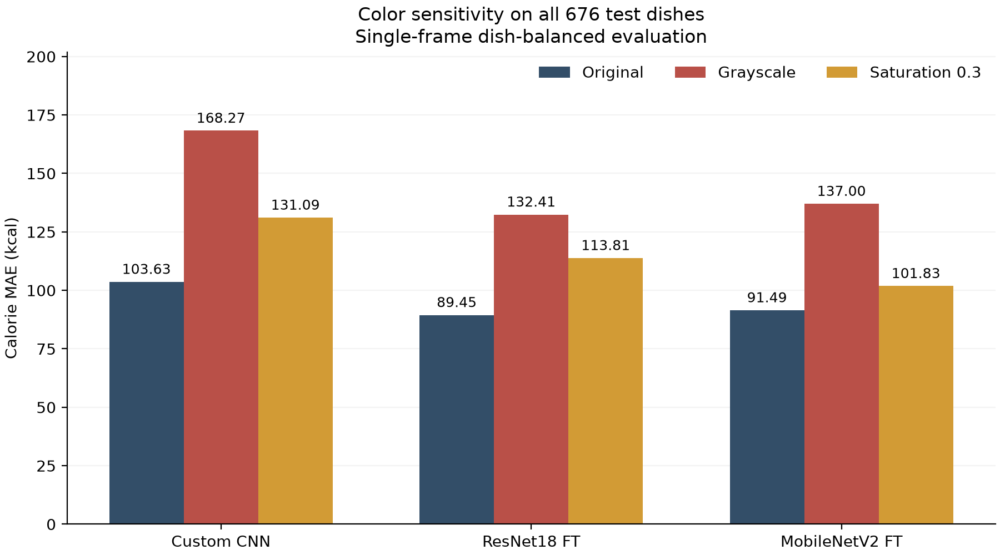

# NutriVision

Single-image nutritional estimation from RGB food photographs using Nutrition5k. The four outputs are calories (kcal), protein, carbohydrates and fat (g). Group 7: 蔡雨静, 曹可昕, 滕姝慧, 汤远航.

## Current status

Five learned checkpoints are trained: Custom CNN, ResNet18 frozen/fine-tuned, and MobileNetV2 frozen/fine-tuned. A mean predictor provides a sixth comparison model. Unified testing, error analysis, color sensitivity and exploratory food shape analysis are complete. The interactive demo remains planned and is not included yet.

## Main test results

Primary evaluation is **single-frame, dish-balanced** on 676 test dishes / 20,686 frames: average frame errors within each dish, then average across dishes. Checkpoints were selected using validation data.

| Model                         | Calorie MAE (kcal) | RMSE (kcal) | R²     |
| ----------------------------- | ------------------:| -----------:| ------:|
| Mean predictor                | 188.34             | 537.09      | -0.005 |
| Custom CNN                    | 103.63             | 507.32      | 0.103  |
| ResNet18 baseline (frozen)    | 127.34             | 514.42      | 0.078  |
| ResNet18 fine-tuned           | 89.45              | 498.09      | 0.136  |
| MobileNetV2 baseline (frozen) | 118.01             | 509.77      | 0.095  |
| MobileNetV2 fine-tuned        | 91.49              | 487.63      | 0.172  |

See [four-target MAE](results/unified/table2_four_targets_MAE.csv), [all metrics](results/unified/metrics_all_levels.csv) and [evaluation report](results/unified/REPORT.md). Secondary dish-level prediction averaging is a separate protocol. It gives calorie MAE 95.48 / 78.77 / 76.61 kcal for CNN / ResNet18 fine-tuned / MobileNetV2 fine-tuned. Two extreme original labels strongly affect RMSE and R². Supplementary results for true calories below 900 kcal exclude all 11 high-calorie dishes, not only the two extremes.

## Color and food shape analysis

Color tests use three fixed models on the full test set. Grayscale increases calorie MAE by 64.64 / 42.97 / 45.52 kcal for CNN / ResNet18 FT / MobileNetV2 FT. Saturation 0.3 increases it by 27.46 / 24.36 / 10.35 kcal. Rotation and flip were not run in this analysis.



Shape analysis sampled 100 distinct test dishes with one fixed frame per dish. Visual screening retained 70 approximate automatic masks and excluded 30 defective masks. Area-error rank correlations weaken after adjustment for true calories. Aspect ratio and circularity show weak calorie-error associations. These observational results do not establish causal shape dependence.

See [methods and analysis commands](docs/color_shape_analysis.md), [color metrics](results/color_shape/color_metrics.csv), [shape correlations](results/color_shape/shape/shape_error_correlations.csv) and [screening decisions](src/analysis/shape_qa_decisions.csv).

## Dataset and models

Prepared dataset: 140,662 frames / 4,605 dishes. Train: 102,087 frames / 3,340 dishes. Validation: 17,889 / 589. Test: 20,686 / 676. Images are side-view frames with RGB resize to 224×224. Splits keep frames from each dish together. Models minimize MSE over four targets standardized using unique training dishes only.

The [manifest](data/manifests/full_frame_manifest.csv), [split IDs](splits/) and [data instructions](data/DOWNLOAD.md) are included. Full images are external. The prepared-frame sharing link is still pending in data/DOWNLOAD.md and must be supplied by the team for a complete data handoff.

The [CNN source](src/models/nutrivision_cnn/nutrivision) implements three 32/64/128-channel convolutional blocks with batch normalization, ReLU and pooling, global average pooling, a 128-to-64-to-4 head and dropout 0.3. [ResNet18/MobileNetV2 source and training instructions](src/models/NutriVision_ResNet18_MobileNetV2/) cover head-only training and partial fine-tuning. Historical per-model dependency files remain in their source directories.

Checkpoint files belong in an external directory or local `models/`. Verify these exact asset names in [GitHub Releases](https://github.com/daisytang71-ai/NutriVision/releases):

| File                    | Model                  |
| ----------------------- | ---------------------- |
| cnn_best.pt             | Custom CNN             |
| Resnet_baseline.pt      | ResNet18 frozen        |
| Resnet_finetune.pt      | ResNet18 fine-tuned    |
| MobileNetV2_baseline.pt | MobileNetV2 frozen     |
| MobileNetV2_finetune.pt | MobileNetV2 fine-tuned |

Release asset availability must be checked by the team. Checkpoints and full images are not bundled in the source repository.

## Quick start

Run from the repository root. Python 3.12 is recommended for the recorded analysis environment. Install a compatible torch/torchvision pair for your device. Keep an existing compatible CUDA installation rather than replacing it blindly.

```bash
python -m venv .venv
source .venv/bin/activate
python -m pip install -r requirements.txt
```

On Windows, activate with `.venv\Scripts\Activate.ps1` in PowerShell.

### Recompute metrics from supplied predictions

No images, checkpoints or retraining are needed for this step. Use a new output directory to preserve committed results.

```bash
NV_RES_DIR=work/metrics_check python src/evaluation/compute_unified_metrics.py
```

PowerShell: `$env:NV_RES_DIR="work/metrics_check"` then run the Python command without the prefix. Metric recomputation also writes supplementary tables into the selected output directory.

### Generate new six-model predictions

```bash
python src/evaluation/run_unified_evaluation.py \
  --manifest data/manifests/full_frame_manifest.csv \
  --data-root /path/to/side_frames_valid \
  --models-dir /path/to/checkpoints \
  --out-dir work/new_predictions
```

Use `--workers 0` if multiprocessing is unavailable. See [unified evaluation](docs/unified_evaluation.md) for the full workflow. For CNN-only testing with the current manifest use the compatibility-aware command in [CNN testing](docs/cnn_testing.md).

### Predict one image with CNN

```bash
cd src/models/nutrivision_cnn
python -m nutrivision.predict --checkpoint /path/to/cnn_best.pt --image /path/to/food.jpg --device auto
```

## Remaining delivery

Build a simple image-upload demo, complete data/model download instructions, and consolidate final figures and documentation. A small additional ablation is optional if time permits.

