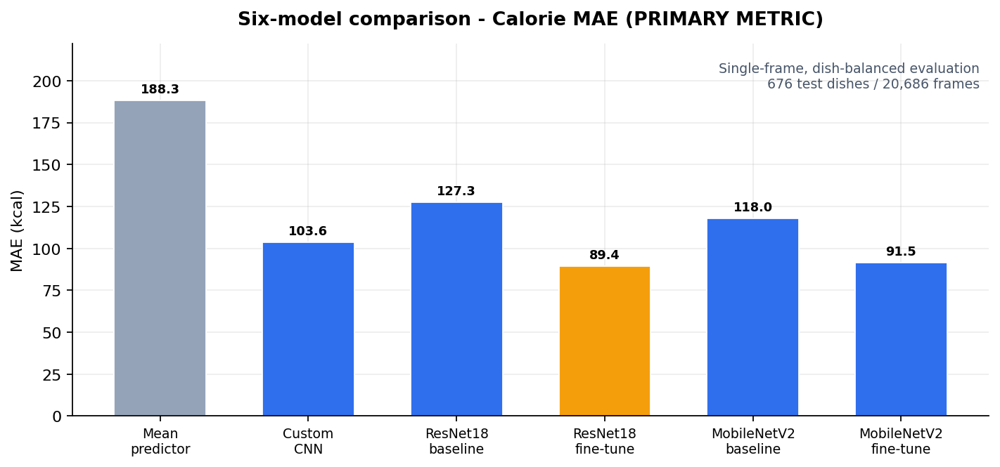
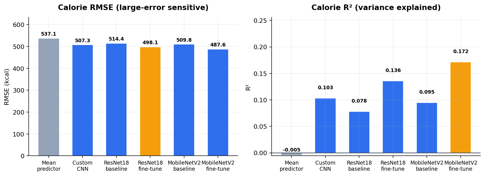
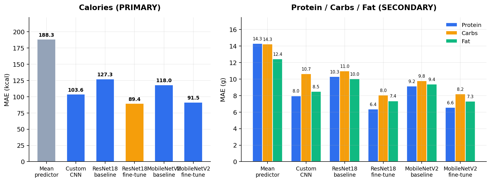
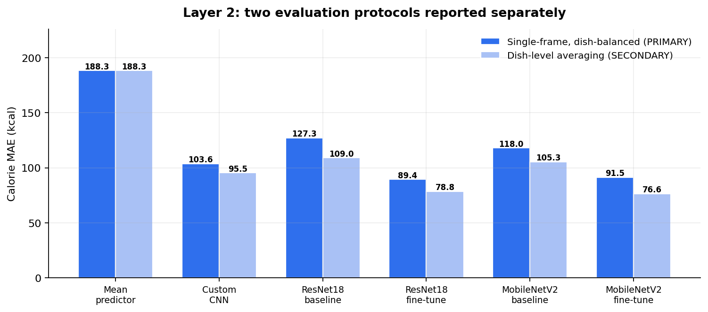
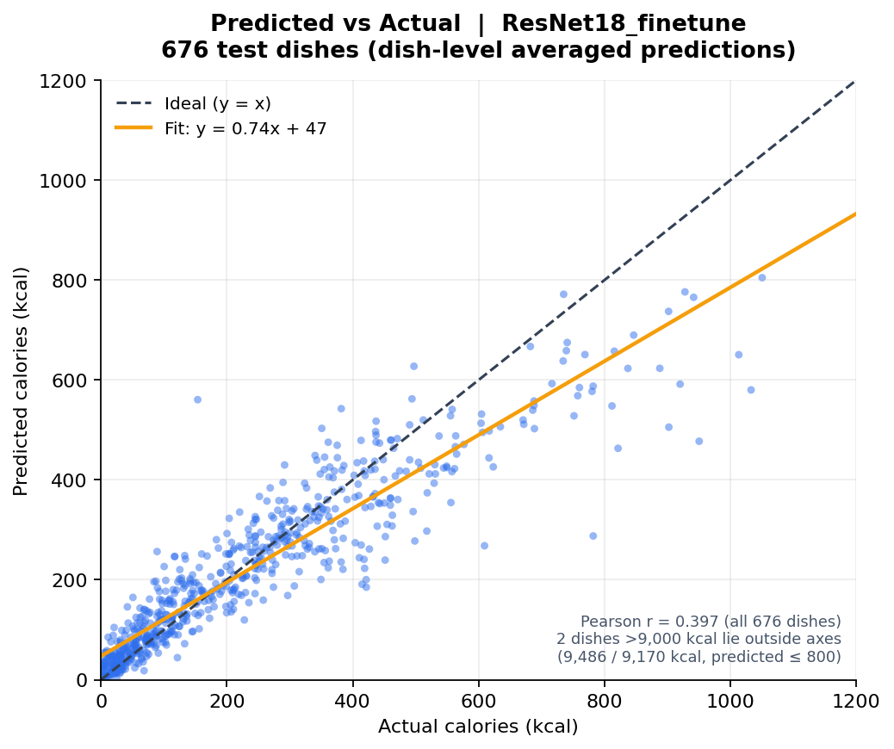
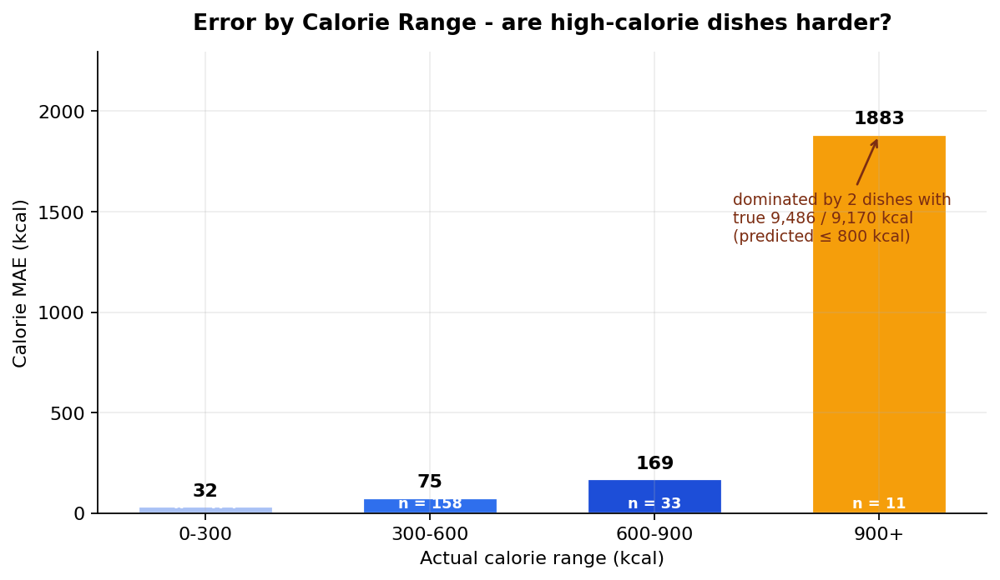
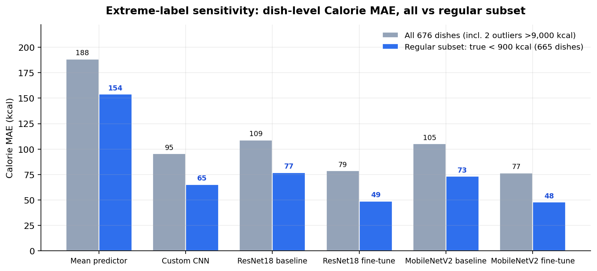
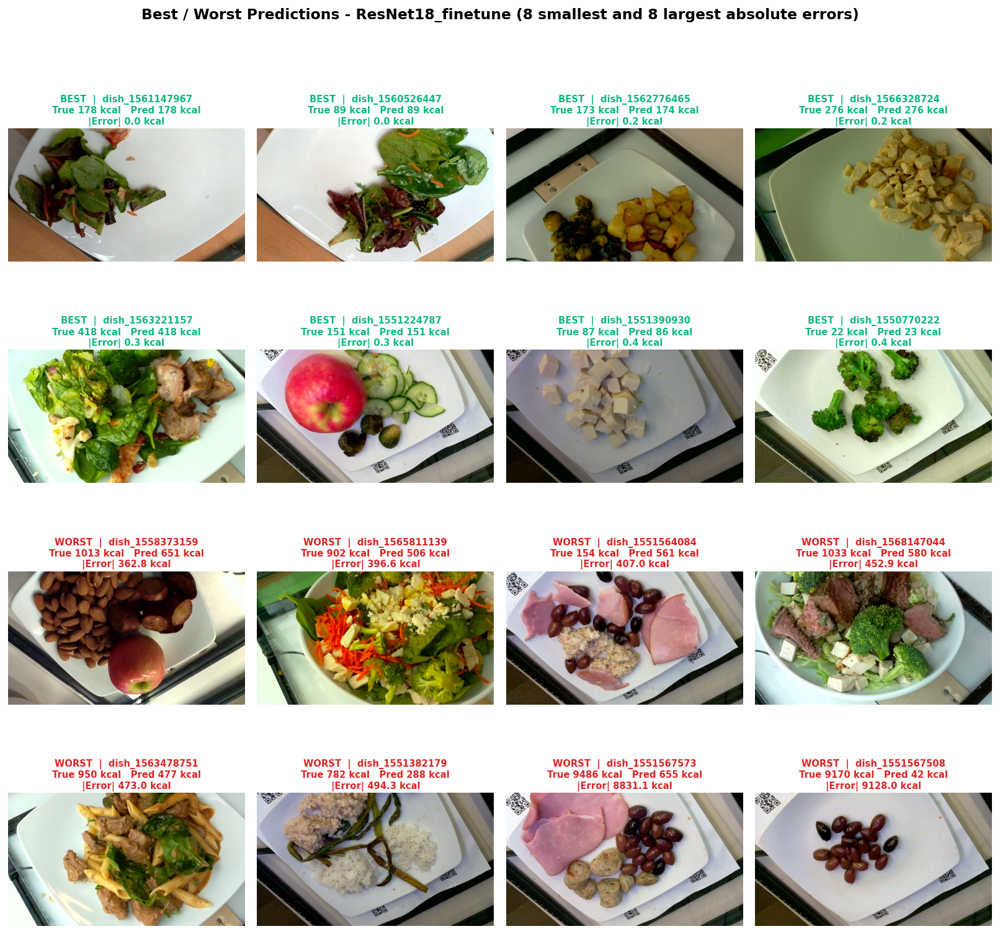

# NutriVision Evaluation Report（评估结果报告）

> 生成时间：2026-11-22 19:51 ｜ 测试集：**676 个 test dishes / 20686 帧**（dish-disjoint，无泄漏）

## 0. 评估方案（与老师建议完全对齐）

| 层次 | 内容 | 口径 |
|---|---|---|
| 第一层 | 六模型性能比较（必须） | 相同 676 个 test dishes，MAE / RMSE / R² |
| 第二层 | Single-frame vs Dish-level（必须） | Primary = Single-frame dish-balanced；Secondary = Dish-level averaging |
| 第三层 | Error Analysis（推荐） | Predicted vs Actual ＋ Error by Calorie Range ＋ Best/Worst Cases |

- **Primary Metric：Calorie MAE**；Secondary Metrics：Protein / Carbs / Fat MAE
- 所有模型使用**同一份评估脚本**，输出**统一格式 CSV**：`dish_id, frame_path, true_calories, pred_calories, true_protein, pred_protein, true_carbs, pred_carbs, true_fat, pred_fat`
- 所有 checkpoint 均基于 **Validation Set** 选择（训练时的 early stopping / 最低验证集 dish-level Calorie MAE），未使用任何测试集信息做模型选择。
- 第六个模型 **Mean Predictor** 为非学习基线（直接预测训练集 dish 均值），来自仓库 README 的模型列表，用于补齐“六模型”比较并给出学习模型必须超越的下限。

## 1. 模型与 checkpoint 信息

| 模型 | Checkpoint | Stage / Epoch | 验证集 dish Calorie MAE (kcal) |
|---|---|---|---|
| Mean predictor | MeanPredictor | - / - | —（非学习基线） |
| Custom CNN | CustomCNN | - / 9 | —（非学习基线） |
| ResNet18 baseline (frozen) | ResNet18_baseline | 1 / 4 | 91.38 |
| ResNet18 fine-tuned | ResNet18_finetune | 2 / 26 | 56.54 |
| MobileNetV2 baseline (frozen) | MobileNetV2_baseline | 1 / 12 | 88.58 |
| MobileNetV2 fine-tuned | MobileNetV2_finetune | 2 / 28 | 59.33 |

## 2. 第一层：六模型性能比较（Primary 口径）

### 2.1 Calorie MAE / RMSE / R²（必须）

| Model | Calorie MAE (kcal) ⭐ | Calorie RMSE (kcal) | Calorie R² |
|---|---|---|---|
| Mean predictor | **188.34** | 537.09 | -0.005 |
| Custom CNN | **103.63** | 507.32 | 0.103 |
| ResNet18 baseline (frozen) | **127.34** | 514.42 | 0.078 |
| ResNet18 fine-tuned ⭐ | **89.45** | 498.09 | 0.136 |
| MobileNetV2 baseline (frozen) | **118.01** | 509.77 | 0.095 |
| MobileNetV2 fine-tuned | **91.49** | 487.63 | 0.172 |

⭐ = 在 Primary 口径下 Calorie MAE 最优的模型：**ResNet18 fine-tuned**





### 2.2 四种营养目标的 MAE（必须）

| Model | Calories MAE (kcal) | Protein MAE (g) | Carbs MAE (g) | Fat MAE (g) |
|---|---|---|---|---|
| Mean predictor | 188.34 | 14.33 | 14.25 | 12.44 |
| Custom CNN | 103.63 | 7.98 | 10.66 | 8.49 |
| ResNet18 baseline (frozen) | 127.34 | 10.32 | 10.99 | 10.04 |
| ResNet18 fine-tuned | 89.45 | 6.37 | 8.05 | 7.37 |
| MobileNetV2 baseline (frozen) | 118.01 | 9.16 | 9.80 | 9.37 |
| MobileNetV2 fine-tuned | 91.49 | 6.57 | 8.20 | 7.30 |



## 3. 第二层：Single-frame 与 Dish-level 两种评估（分别报告，不混用）

**口径定义（报告中已明确统计单位）：**

- **Primary — Single-frame, dish-balanced**：每道菜先算所有测试帧的平均绝对误差，再对 676 道菜取平均。RMSE/R² 同样在每个 dish 内先汇总平方误差再总体计算（不是把各 dish 的 RMSE 简单平均）。
- **Secondary — Dish-level prediction averaging**：每道菜先对所有帧的预测取平均，再对 676 道菜计算指标（即 Stage 2 使用的多帧融合方式，用于观察多帧融合带来的改善）。
- Frame-level（全部帧等权）仅作为对照列出——它会给帧数多的菜更高权重，因此不作为主口径。

| Model | Single-frame MAE | Single-frame RMSE | Single-frame R² | Dish-level MAE | Dish-level RMSE | Dish-level R² | 多帧融合改善 |
|---|---|---|---|---|---|---|---|
| Mean predictor | 188.34 | 537.09 | -0.005 | 188.34 | 537.09 | -0.005 | 0.0% |
| Custom CNN | 103.63 | 507.32 | 0.103 | 95.48 | 504.84 | 0.112 | 7.9% |
| ResNet18 baseline (frozen) | 127.34 | 514.42 | 0.078 | 109.03 | 510.26 | 0.093 | 14.4% |
| ResNet18 fine-tuned | 89.45 | 498.09 | 0.136 | 78.77 | 495.45 | 0.145 | 11.9% |
| MobileNetV2 baseline (frozen) | 118.01 | 509.77 | 0.095 | 105.33 | 506.79 | 0.105 | 10.7% |
| MobileNetV2 fine-tuned | 91.49 | 487.63 | 0.172 | 76.61 | 483.88 | 0.184 | 16.3% |

所有指标均以 Calorie 为例；四目标完整指标见 `results/metrics_all_levels.csv`。



## 4. 第三层：Error Analysis（推荐；误差分析模型按验证集选择）

误差分析使用的模型：**ResNet18_finetune**（选择依据：验证集 dish-level Calorie MAE 最低 = 56.54 kcal，不使用测试集做选择）。

### 4.1 Predicted vs. Actual

- 全部 676 道菜拟合：`Predicted = 0.122 × Actual + 183.0`，Pearson r = 0.397（被 2 个极端 dish 严重扭曲）
- **常规区间**（true < 900 kcal，665 道菜）拟合：`Predicted = 0.767 × Actual + 42.5`，Pearson r = 0.926
- 斜率 < 1，说明模型对高热量菜品存在**系统性低估**（regression to the mean）。
- 图中坐标轴截断至 1,200 kcal：2 个真实热量 >9,000 kcal 的 dish（9,486 / 9,170 kcal）超出坐标范围，任何模型（包括均值基线）都无法从图像预测它们——训练集标签本身不超过约 1,300 kcal。



### 4.2 Error by Calorie Range

| 真实热量区间 (kcal) | Dish 数 | Calorie MAE (kcal) | 平均偏差 Pred−True (kcal) |
|---|---|---|---|
| 0-300 | 474 | 31.94 | 16.35 |
| 300-600 | 158 | 74.82 | -46.58 |
| 600-900 | 33 | 168.95 | -166.74 |
| 900+ | 11 | 1882.81 | -1882.81 |



### 4.3 极端标签敏感性（RMSE / R² 的关键注意事项）

测试集中有 **11 个 dish 的真实热量 ≥ 900 kcal**，其中 2 个高达 **9,486 / 9,170 kcal**。它们的平方误差主导了所有模型的 RMSE 与 R²（包括均值基线），而训练集标签最大约 1,300 kcal，模型在原理上无法外推到 9,000+ kcal。因此 RMSE / R² 应结合"常规子集"一起解读：

| Model | 全部 676 dish MAE | 常规子集 MAE (true<900, n=665) | 全部 676 RMSE | 常规子集 RMSE | 全部 676 R² | 常规子集 R² |
|---|---|---|---|---|---|---|
| Mean predictor | 188.34 | **153.96** | 537.09 | 189.23 | -0.005 | **-0.000** |
| Custom CNN | 95.48 | **65.24** | 504.84 | 97.92 | 0.112 | **0.732** |
| ResNet18 baseline (frozen) | 109.03 | **77.06** | 510.26 | 114.72 | 0.093 | **0.632** |
| ResNet18 fine-tuned | 78.77 | **48.93** | 495.45 | 74.20 | 0.145 | **0.846** |
| MobileNetV2 baseline (frozen) | 105.33 | **73.32** | 506.79 | 106.06 | 0.105 | **0.686** |
| MobileNetV2 fine-tuned | 76.61 | **48.05** | 483.88 | 73.37 | 0.184 | **0.850** |

> 这正是 RMSE "关注大误差样本" 的作用：排除极端标签后，常规菜品的 MAE 约 48.05–153.96 kcal，R² 大幅提升，说明模型在正常菜品区间表现良好。



### 4.4 Best / Worst Predictions

| Case | Dish ID | 真实热量 (kcal) | 预测热量 (kcal) | 绝对误差 (kcal) |
|---|---|---|---|---|
| best | dish_1561147967 | 178 | 178 | 0.0 |
| best | dish_1560526447 | 89 | 89 | 0.0 |
| best | dish_1562776465 | 173 | 174 | 0.2 |
| best | dish_1566328724 | 276 | 276 | 0.2 |
| best | dish_1563221157 | 418 | 418 | 0.3 |
| best | dish_1551224787 | 151 | 151 | 0.3 |
| best | dish_1551390930 | 87 | 86 | 0.4 |
| best | dish_1550770222 | 22 | 23 | 0.4 |
| worst | dish_1558373159 | 1013 | 651 | 362.8 |
| worst | dish_1565811139 | 902 | 506 | 396.6 |
| worst | dish_1551564084 | 154 | 561 | 407.0 |
| worst | dish_1568147044 | 1033 | 580 | 452.9 |
| worst | dish_1563478751 | 950 | 477 | 473.0 |
| worst | dish_1551382179 | 782 | 288 | 494.3 |
| worst | dish_1551567573 | 9486 | 655 | 8831.1 |
| worst | dish_1551567508 | 9170 | 42 | 9128.0 |



## 5. 结论要点（可直接写进 PPT / 汇报词）

1. **六模型统一比较**（相同 676 test dishes、相同脚本）：ResNet18 fine-tuned 以 Calorie MAE = 89.45 kcal 最优，Mean predictor 基线为 188.34 kcal——所有学习模型都显著优于非学习基线。
2. **两种评估口径分开报告**：单帧 dish-balanced 口径回答 Research Question 1（单图预测能力）；dish-level averaging 口径显示多帧融合能进一步降低 MAE（改善幅度见第 3 节表格）。
3. **误差分析**：误差随真实热量区间上升；常规区间内拟合斜率 < 1，说明模型对高热量菜品存在系统性低估。Best/Worst 案例展示了模型表现好/差的具体食物类型。
4. **极端标签发现（亮点）**：测试集中 2 个 dish 真实热量高达 9,486 / 9,170 kcal，主导了所有模型的 RMSE 与 R²（包括均值基线）；排除后常规子集 R² 大幅提升。建议汇报时把这一点作为"为什么 RMSE 高、R² 低"的核心解释，并可讨论后续改进（如对标签做 log 变换或截断训练范围）。
5. **严谨性**：checkpoint 全部基于验证集选择；所有模型用同一脚本与统一 CSV；dish-disjoint 划分避免数据泄漏。

## 6. 方法细节与文件清单

- 评估脚本：`src/evaluation/run_unified_evaluation.py`（推理）→ `compute_unified_metrics.py`（三层指标）→ `make_unified_figures.py`（图表）→ `generate_unified_report.py`（本报告）；运行说明见 `docs/unified_evaluation.md`
- 预测 CSV（统一格式，每模型 20,686 行）：`predictions/unified/predictions_<model>.csv`
- 指标明细：`results/metrics_all_levels.csv`（model × target × evaluation level）
- PPT 用表：`results/table1_six_model_calorie.csv`、`table2_four_targets_MAE.csv`、`table3_single_vs_dish.csv`、`error_by_calorie_range.csv`、`robust_subset_metrics.csv`、`extreme_dishes_over_900kcal.csv`、`best_worst_cases.csv`
- 图表（160 dpi PNG，白底，可直接插入 PPT）：`evaluation/figures/fig1…fig7` 与 `fig6b`

### 口径公式

```text
Single-frame, dish-balanced (D = 676 dishes, n_i = frames of dish i):
  MAE  = (1/D) Σ_i (1/n_i) Σ_j |e_ij|
  MSE  = (1/D) Σ_i (1/n_i) Σ_j e_ij²      RMSE = √MSE
  R²   = 1 − MSE / Var_db(y),  Var_db 使用同一 dish-balanced 权重

Dish-level averaging:
  先对每道菜所有帧预测取平均 p̄_i，再对 676 个 (y_i, p̄_i) 计算 MAE/RMSE/R²
```
